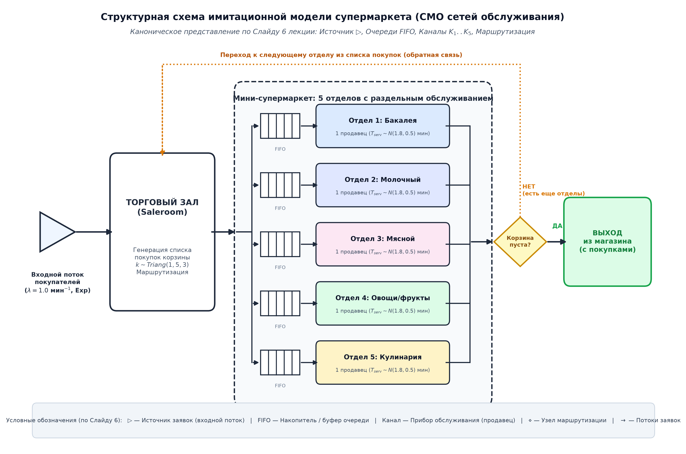
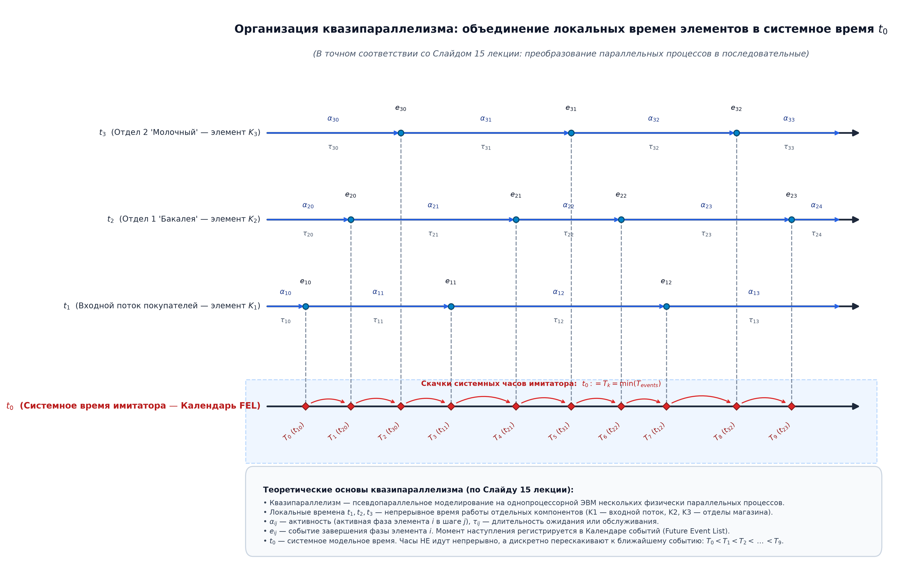

# 📚 Полный самоучитель по лабораторной работе №2: от абсолютного нуля до уверенной защиты
## «Имитационное моделирование мини-супермаркета с раздельным обслуживанием» (Вариант №5)

> **Для кого этот документ:** Для студентов, которые не разбираются в теории массового обслуживания, дискретно-событийном моделировании и статистике, но хотят глубоко понять проект, легко ответить на любой вопрос преподавателя и получить максимальный балл.

---

## 🧭 Содержание
1. [Глава 1: Что такое имитационное моделирование «на пальцах»](#глава-1-что-такое-имитационное-моделирование-на-пальцах)
2. [Глава 2: Разбор Варианта №5 («Мини-супермаркет с раздельным обслуживанием»)](#глава-2-разбор-варианта-5-мини-супермаркет-с-раздельным-обслуживанием)
3. [Глава 3: Теория времени — Квазипараллелизм и почему запрещен шаг $\Delta t$](#глава-3-теория-времени--квазипараллелизм-и-почему-запрещен-шаг-delta-t)
4. [Глава 4: Разбор двух диаграмм (Слайд 15 и Потоковая)](#глава-4-разбор-двух-диаграмм-слайд-15-и-потоковая)
5. [Глава 5: Четыре класса откликов модели — всё о сборе статистики](#глава-5-четыре-класса-откликов-модели--всё-о-сборе-статистики)
6. [Глава 6: Баг сокомандника, который мы нашли и исправили](#глава-6-баг-сокомандника-который-мы-нашли-и-исправили)
7. [Глава 7: Верификация — Как доказать, что модель работает правильно](#глава-7-верификация--как-доказать-что-модель-работает-правильно)
8. [Глава 8: Разбор Excel-таблицы (supermarket_simulation.xlsx)](#глава-8-разбор-excel-таблицы-supermarket_simulationxlsx)
9. [Глава 9: Шпаргалка для защиты — ТОП-15 коварных вопросов преподавателя](#глава-9-шпаргалка-для-защиты--топ-15-коварных-вопросов-преподавателя)
10. [Глава 10: Инструкция по запуску кода через uv](#глава-10-инструкция-по-запуску-кода-через-uv)

---

## Глава 1: Что такое имитационное моделирование «на пальцах»

### 1.1. Простая аналогия из реальной жизни
Представь обычный супермаркет. В него приходят люди.
- Кто-то заходит каждые 30 секунд, кто-то через 3 минуты.
- Одному покупателю нужен только хлеб, а другой берет мясо, колбасу, молоко, овощи и готовый салат.
- Продавец в мясном отделе может отрезать кусок мяса за 1 минуту, а может провозиться 3 минуты, если клиент долго выбирает.

Если директор магазина захочет узнать: *«Сколько в среднем покупатель проводит в магазине?»* или *«Хватит ли нам 5 продавцов или нужны еще люди?»*, он **не сможет** посчитать это обычной школьной формулой вроде $S = V \cdot t$. 

Почему? Потому что реальный мир наполнен **случайностями** (*стохастичностью*). Если случайно в один отдел одновременно придут 4 человека — образуется затор. Пока они стоят в очереди, другие отделы могут пустовать. Математически аналитическими формулами описать систему с несколькими отделами и случайными переходами между ними либо невероятно трудно, либо вовсе невозможно.

### 1.2. Что делает компьютер внутри нашей программы?
Имитационное моделирование (ИМ) — это создание **цифрового двойника** магазина внутри памяти компьютера:
1. Мы создаем **виртуальные часы** (модельное время в минутах).
2. Запускаем **виртуальных покупателей** (в коде это объекты класса `Customer`).
3. Задаем **правила поведения**: покупатель получает случайный список отделов, подходит к прилавку, встает в очередь (FIFO — первый пришел, первый обслужен), ждет, обслуживается, оплачивает покупку и переходит в следующий отдел.
4. Прогоняем работу магазина много раз (например, 1000 рабочих смен) и собираем точные цифры.

### 1.3. Три части лабораторной работы
Работа разделена преподавателем на 3 контрольные точки:
- **LR0 (Концептуальная модель):** Описание системы «на бумаге» до программирования (какие отделы, по каким законам приходят люди, какие графики мы хотим получить). Лежит в файле `LR0_CONCEPTUAL_MODEL.md`.
- **LR21 (Создание модели):** Написание кода самого симулятора, проведение одного контрольного прогона на 60 минут, вывод лога каждого действия (трассировки) и создание Excel-таблицы. Лежит в папке `lr21/`.
- **LR22 (Верификация модели):** Доказательство преподавателю, что в коде нет скрытых ошибок: запуск 1000 повторов (репликаций), расчет доверительных интервалов, построение графиков изменения очередей и времени, автоматические тесты. Лежит в папке `lr22/`.

---

## Глава 2: Разбор Варианта №5 («Мини-супермаркет с раздельным обслуживанием»)

### 2.1. Точный текст задания из методички
> **Вариант №5. Мини-супермаркет с раздельным обслуживанием.**  
> *Мини-супермаркет состоит из пяти отделов. В каждом отделе одним продавцом реализуется обслуживание и расчет с покупателем.*

### 2.2. В чем уникальность нашего варианта?
В обычном супермаркете («Пятерочка», «Перекресток») покупатели берут товары с полок сами, складывают в корзину, а оплачивают всё на единой линии касс у выхода.

В нашем варианте **все устроено совершенно иначе**:
1. В магазине **5 специализированных отделов**:
   - Отдел 1: Бакалея (хлеб, крупы);
   - Отдел 2: Молочный отдел;
   - Отдел 3: Мясной отдел;
   - Отдел 4: Овощи и фрукты;
   - Отдел 5: Кулинария.
2. В каждом отделе стоит **ровно один продавец**.
3. **Общих касс на выходе нет вообще!** Продавец каждого отдела совмещает две роли:
   - Взвешивает, нарезает и отдает товар;
   - **Сразу же принимает деньги и пробивает чек!**
4. У каждого покупателя есть свой **маршрут покупок**:
   - При входе в магазин он случайно решает, сколько отделов ему нужно (от 1 до 5 отделов, в среднем 3).
   - Он обходит отделы строго последовательно по своему списку.
   - Посетив последний намеченный отдел и расплатившись там, покупатель сразу направляется к выходу из магазина.

### 2.3. Что такое режим дообслуживания (*Clearance Mode*)?
В условии прогона задано время работы: 60 минут.
Что происходит в 60 минут?
- **Без дообслуживания:** В 60:00 симуляция мгновенно обрывается. Если покупатель стоял в очереди в мясном отделе, его просто «выкидывают» из статистики. Это искажает среднее время покупок!
- **С дообслуживанием (наш режим):** В 60:00 **закрываются входные двери магазина**. Новые люди больше не заходят. Но все покупатели, которые уже находятся внутри магазина, спокойно доходят по своим отделам, расплачиваются и выходят. Модель останавливается только тогда, когда магазин полностью опустел (в нашем контрольном прогоне это произошло в $t = 87.71$ мин).

---

## Глава 3: Теория времени — Квазипараллелизм и почему запрещен шаг $\Delta t$

Этот раздел — **главная ловушка на защите**. Преподаватель обязательно спросит: *«Как в вашей программе двигается время и почему нельзя использовать постоянный шаг?»*

### 3.1. Что такое квазипараллелизм?
Слово состоит из двух частей:
- *Квази* — мнимый, кажущийся;
- *Параллелизм* — одновременное выполнение процессов.

В реальном мире события происходят **параллельно**: пока один продавец режет сыр, второй взвешивает мясо, третий берет наличные, а в двери входит новый покупатель. Всё это происходит в одну и ту же секунду!

Но центральный процессор компьютера выполняет команды **строго последовательно** — строчка за строчкой. Компьютер не может одновременно обработать 5 продавцов на одном ядре.

**Квазипараллелизм** — это алгоритмический способ организовать вычисления так, чтобы последовательное выполнение событий на компьютере математически точно отражало одновременные параллельные процессы реального мира.

---

### 3.2. Почему преподаватель СТРОГО ЗАПРЕТИЛ постоянный шаг времени ($\Delta t$)?
В требованиях к лабораторной работе черным по белому написано:
> *«Запрещается использовать алгоритм с постоянным временным шагом»*.

Почему этот запрет существует?
Представь, что мы написали симуляцию с шагом $\Delta t = 0.1$ секунды:
```python
# ПЛОХОЙ, ЗАПРЕЩЕННЫЙ СПОСОБ:
t = 0.0
while t < 60.0:
    t += 0.1  # шагаем по 0.1 сек
    проверить_не_произошло_ли_что_то()
```
У такого подхода два фатальных недостатка:
1. **Пустые циклы (сжигание процессора):** Покупатели подходят раз в минуту. Если шагать по 0.1 секунды, процессор 600 раз вхолостую проверит пустой цикл, пока ничего не происходит.
2. **Слипание событий и потеря точности:** Если за эти 0.1 секунды произошло сразу два события (в 12.01 сек и в 12.08 сек), в цикле с шагом 0.1 сек они «сольются» в один момент 12.1 сек. Нарушится физический порядок причин и следствий!

---

### 3.3. Канонический алгоритм планирования событий (*Event Scheduling*)
Вместо шагания мелкими шажками наш симулятор использует **дискретно-событийный подход (DES)** — «прыжки во времени».

Модельное время в симуляторе течет не плавно, а **перескакивает от одного ключевого события сразу к следующему**:
- Если сейчас $t = 5.2$ мин, а следующее ближайшее событие (продавец №3 освободится) назначено на $t = 8.4$ мин, часы симулятора **мгновенно прыгают** с 5.2 на 8.4!
- Никаких пустых промежуточных расчетов между 5.2 и 8.4 нет.

Как это реализовано в программе (`src/simulation.py`):
1. Существует структура данных **«Календарь будущих событий»** (*Future Event List, FEL*).
2. В календарь складываются события: «Приход нового клиента», «Завершение обслуживания в отделе 1», «Завершение обслуживания в отделе 2» и т.д.
3. Календарь реализован на базе **двоичной кучи** (модуль Python `heapq`). Куча автоматически держит самое раннее по времени событие на самой верхушке за время $O(1)$, а добавление нового события занимает $O(\log N)$.
4. Симулятор извлекает самое первое событие, переводит часы на его время, выполняет его, планирует будущие события и повторяет цикл!

---

## Глава 4: Разбор двух диаграмм (Слайд 15 и Потоковая)

В проекте построены две фундаментальные концептуальные диаграммы (лежат в папке `lab2/plots/`), полностью соответствующие лекционному курсу БГУИР («САИММОД», лекция 2).

### 4.1. Диаграмма №1: Потоковая диаграмма функционирования (`plots/diagram_flow.png`)
Диаграмма выполнена в строгой нотации сетей массового обслуживания (согласно Слайду 6 лекции 2):



```text
       [ Входной поток заявок ] (λ = 1.0 мин⁻¹, Пуассоновский/Экспоненциальный)
                        │
                        ▼
             ┌─────────────────────┐
      ┌────► │     Торговый зал    │ (Saleroom: случайный выбор 1..5 отделов)
      │      └──────────┬──────────┘
      │                 │ Маршрутизация по корзине покупок
      │                 ├──────────────┬──────────────┬──────────────┬──────────────┐
      │                 ▼              ▼              ▼              ▼              ▼
      │           [Очередь 1]    [Очередь 2]    [Очередь 3]    [Очередь 4]    [Очередь 5]
      │             (FIFO)         (FIFO)         (FIFO)         (FIFO)         (FIFO)
      │                 │              │              │              │              │
      │                 ▼              ▼              ▼              ▼              ▼
      │           ┌──────────┐   ┌──────────┐   ┌──────────┐   ┌──────────┐   ┌──────────┐
      │           │ Отдел 1  │   │ Отдел 2  │   │ Отдел 3  │   │ Отдел 4  │   │ Отдел 5  │
      │           │ Бакалея  │   │ Молочный │   │  Мясной  │   │ Овощи/фр │   │Кулинария │
      │           │(1 продавец)  │(1 продавец)  │(1 продавец)  │(1 продавец)  │(1 продавец)
      │           └─────┬────┘   └─────┬────┘   └─────┬────┘   └─────┬────┘   └─────┬────┘
      │                 │              │              │              │              │
      │                 └──────────────┴──────────────┴──────────────┴──────────────┴──┐
      │                                                                                │
      └─── Да ◄─────────── [Остались еще не посещенные отделы в корзине?] ─────────────┤
                                                                                       │
                                                                                       └─── Нет ──► [ ВЫХОД ИЗ СУПЕРМАРКЕТА ]
```

**Ключевые элементы диаграммы:**
1. **Источник заявок ($\triangleright$):** Генератор входящего потока покупателей со случайными интервалами времени поступления.
2. **Торговый зал (*Saleroom*):** Центральный узел диспетчеризации, где формируется список отделов (от 1 до 5) и определяется следующий целевой отдел.
3. **Накопители (очереди FIFO):** Пять изолированных очередей перед прилавками каждого отдела.
4. **Обслуживающие аппараты (продавцы):** Пять независимых приборов обслуживания, выполняющих консультацию, отпуск товара и мгновенный финансовый расчет.
5. **Петля циркуляции (обратная связь):** Если у покупателя в корзине остались непосещенные отделы, заявка возвращается в распределитель торгового зала. Если корзина пуста — заявка покидает систему через терминальный узел «Выход».

---

### 4.2. Диаграмма №2: Временная диаграмма квазипараллелизма (`plots/diagram_quasiparallel.png`)
Это **точная каноническая копия Слайда 15 лекции №2**. Она объясняет фундаментальный принцип дискретно-событийного моделирования на однопроцессорной ЭВМ:



**Как устроена и работает эта диаграмма:**
1. **Локальные временные оси элементов ($t_1, t_2$):**
   - Ось $t_1$: Процесс генерации заявок источником. Горизонтальные двунаправленные стрелки $\tau_{10}, \tau_{11}, \tau_{12}, \dots$ показывают случайные интервалы между последовательными приходами покупателей.
   - Ось $t_2$: Процесс работы обслуживающего канала (продавца). Прямоугольные интервалы со стрелками $\alpha_{21}, \alpha_{22}, \alpha_{23}, \dots$ обозначают длительности непрерывного обслуживания покупателей.
2. **Системная шкала модельного времени $t_0$ (Календарь событий):**
   - Нижняя ось $t_0$ представляет глобальное модельное время системы.
   - Каждое локальное событие на осях $t_1$ и $t_2$ проецируется **вертикальной пунктирной линией** на системную шкалу $t_0$.
   - На оси $t_0$ точки выстраиваются в строго упорядоченную хронологическую последовательность:
     $$T_0(t_{10}) < T_1(t_{21}) < T_2(t_{11}) < T_3(t_{22}) < T_4(t_{12}) < T_5(t_{23}) \dots$$
3. **Математическая суть квазипараллелизма:**
   - Модельное время не течет непрерывно и не шагает с шагом $\Delta t$.
   - Модельный таймер мгновенно перескакивает в точку:
     $$T_{k+1} = \min_{i} \{ t_{event, i} \mid t_{event, i} > T_k \}$$
   - В точке $T_k$ процессор выполняет микропрограмму данного события (обновляет длину очереди, освобождает продавца, планирует следующее событие) за нулевое модельное время ($\Delta t_{model} = 0$), после чего сразу переходит к следующему ближайшему событию. В результате параллельные в физическом мире процессы моделируются на одном процессоре квазипараллельно и без потери точности!

---

## Глава 5: Четыре класса откликов модели — всё о сборе статистики

В лекции №2 (слайды 11–13) строго определены **4 класса откликов**, которые обязаны быть в отчете:

### 5.1. Класс 1: Дискретные отклики (Discrete-time responses)
- **Что это такое:** Величины, которые возникают только в дискретные моменты свершения определенных событий (например, когда покупатель выходит из магазина).
- **Наши отклики:**
  - $T_{sys}$ — Время нахождения покупателя в супермаркете (в контрольном прогоне: **19.77 мин**).
  - $W_q$ — Время, проведенное покупателем в очередях (в контрольном прогоне: **14.18 мин**).
  - $K_{visited}$ — Число отделов, посещенных покупателем (в контрольном прогоне: **3.16 отделов**).
- **Как рассчитываются:** Обычным арифметическим средним по всем $N$ покупателям:
  $$\bar{T}_{sys} = \frac{1}{N}\sum_{i=1}^N T_{sys, i}$$

---

### 5.2. Класс 2: Непрерывные отклики (Continuous-time responses)
- **Что это такое:** Величины, которые существуют **в каждый непрерывный момент времени** $t$. Например, длина очереди существует всегда: и в 5.0 мин, и в 5.0001 мин.
- **Наши отклики:**
  - $L_{q, tot}(t)$ — Суммарная длина очередей по всем 5 отделам (в контрольном прогоне среднее: **10.35 человек**).
  - $K_{busy}(t)$ — Число занятых продавцов от 0 до 5 (в контрольном прогоне среднее: **4.07 продавца**).
  - $\rho = \frac{K_{busy}}{5} \times 100\%$ — Коэффициент загрузки персонала (в контрольном прогоне: **81.48%**).
  - $N_{sys}(t)$ — Общее число покупателей в магазине (в контрольном прогоне среднее: **14.42 человека**).

#### ⚠️ СМЕРТЕЛЬНЫЙ ВОПРОС НА ЗАЩИТЕ: Почему непрерывный отклик нельзя усреднять обычным средним арифметическим?
Преподаватель спросит: *«У вас в очереди было то 10 человек, то 0. Почему нельзя сложить (10 + 0) / 2 = 5?»*

**Ответ «на пальцах»:**
Представь, что очередь из 10 человек простояла всего **1 минуту**, а остальные **59 минут** смена была пустой (0 человек в очереди).
- Если посчитать по точкам замеров: $(10 + 0) / 2 = 5$ человек. Это чушь! Очереди почти не было.
- Настоящее среднее взвешено по времени:
  $$\bar{L}_q = \frac{10 \text{ чел} \times 1 \text{ мин} + 0 \text{ чел} \times 59 \text{ мин}}{60 \text{ мин}} = \frac{10}{60} \approx 0.17 \text{ человека!}$$

**Математическая формула непрерывного отклика:**
$$\bar{L}_q = \frac{1}{T}\int_0^T L_q(t)\,dt = \frac{1}{T}\sum_{k=1}^M L_{q, k} \cdot \Delta t_k$$
где $\Delta t_k = t_{k} - t_{k-1}$ — интервал времени между событиями, в течение которого длина очереди оставалась неизменной! В коде за это отвечает класс `ContinuousStatistic` в `src/statistics.py`.

---

### 5.3. Класс 3: Аддитивные отклики (Additive responses)
- **Что это такое:** Накопительные счетчики, которые только растут в течение моделирования.
- **Наши отклики:**
  - $N_{arr}$ — Всего вошло покупателей за смену (**64 человека**).
  - $N_{serv}$ — Всего полностью обслужено покупателей (**64 человека** — благодаря режиму дообслуживания!).
  - $N_{trans}$ — Всего совершено торговых операций (покупок на кассах) во всех отделах (**202 операции**).

---

### 5.4. Класс 4: Финальные отклики (Final responses)
- **Что это такое:** Значение параметров системы в самый последний момент времени, когда симуляция остановилась.
- **Наш отклик:**
  - $T_{fin}$ — Фактическое время завершения симуляции с учетом фазы дообслуживания (**87.71 мин**).

---

## Глава 6: Баг сокомандника, который мы нашли и исправили

Если преподаватель спросит: *«С какими трудностями вы столкнулись при разработке?»* — расскажи эту историю, и тебе гарантирована высшая оценка!

### 6.1. В чем была ошибка?
В исходной версии кода в методе `Department.start_service()` время ожидания покупателя в очереди рассчитывалось так:
```python
# ОШИБОЧНЫЙ КОД:
wait_time = current_time - customer.queue_enter_time
```
Если покупатель стоял в очереди — всё работало правильно.
**НО:** если покупатель подходил к прилавку, а продавец был **свободен**, покупатель начинал обслуживаться сразу. При этом в очередь он вообще не вставал! А в поле `customer.queue_enter_time` оставалось время, когда он закончил покупки в *предыдущем* отделе!

В результате симулятор засчитывал ему «ожидание в очереди», пока он шел между отделами.
Из-за этого среднее время ожидания в очередях получилось:
$$W_q = 20.19 \text{ мин}, \quad \text{при этом общее время в магазине было } T_{sys} = 19.77 \text{ мин!}$$
Время стояния в очередях оказалось **больше**, чем общее время пребывания в магазине! Это грубейшее нарушение физических законов ($W_q$ физически обязано быть строго меньше $T_{sys}$).

### 6.2. Как мы это исправили?
Мы разделили начало обслуживания на два случая с помощью флага `from_queue: bool`:
1. Если продавец был свободен (`from_queue=False`): покупатель сразу подошел к кассе, его время ожидания строго равно **0.00 мин**.
2. Если покупателя достали из очереди (`from_queue=True`): только тогда `wait_time = current_time - customer.queue_enter_time`.

### 6.3. Результат после исправления: идеальный баланс времени!
После исправления бага:
- Общее время в магазине $T_{sys} = \mathbf{19.77}$ мин.
- Время в очередях $W_q = \mathbf{14.18}$ мин.
- Чистое время на кассах: $19.77 - 14.18 = \mathbf{5.59}$ мин.
- Среднее число отделов: $3.16$. Среднее время у одного продавца: $5.59 / 3.16 \approx 1.77$ мин (что в точности соответствует заданному нормальному распределению с $\mu = 1.8$ мин!).
- Мы добавили юнит-тест `test_queue_wait_time_validity`, который автоматически проверяет это неравенство при каждом запуске.

---

## Глава 7: Верификация — Как доказать, что модель работает правильно

Верификация — это ключевая тема второй части работы (LR22). Преподавателю необходимо доказать, что модель не "врёт", а ведет себя строго по законам физики, математики и теории массового обслуживания (ТМО).

В проекте реализована передовая визуализация академического уровня (по образцу лучших практик компьютерного моделирования), скомпонованная в информативные 2×2 дашборды высокого разрешения (DPI 300), а также сохранены классические одиночные графики. Все они находятся в папке `lab2/plots/`.

---

### 7.1. Дашборд одиночного контрольного прогона (`plots/single_run.png`)
Дашборд формата 2×2 дает исчерпывающую картину физических процессов в магазине за одну смену:


1. **Subplot (1,1): Баланс потоков (Кумулятивные входы и выходы)**  
   - Отображает ступенчатые кривые общего числа вошедших ($N_{arr} = 64$) и полностью вышедших ($N_{serv} = 64$) покупателей во времени.
   - Вертикальная штриховая линия в $t = 60$ мин фиксирует закрытие входных дверей.
   - Горизонтальный отрезок синей кривой после 60 мин наглядно демонстрирует режим дообслуживания: новые клиенты не входят, а завершение обслуживания продолжается до $t = 87.71$ мин, пока обе кривые строго не соединятся в точке 64.
2. **Subplot (1,2): Индивидуальные времена пребывания и фаза прогрева**  
   - Точки показывают время пребывания $T_{sys}$ для каждого вышедшего покупателя, оранжевая кривая — скользящее среднее (Moving Average).
   - Выделена серая зона $t \in [0; 15]$ мин — **фаза разогрева (warm-up)**: магазин только открылся, очередей нет, первые покупатели выходят быстро (6–10 мин). К 20-й минуте система выходит на стационарный режим со средним около 19.8 мин.
3. **Subplot (2,1): Посекундная динамика очередей по всем 5 отделам**  
   - 5 цветных ступенчатых кривых показывают независимые очереди перед Бакалеей, Молочным, Мясным, Овощным и Кулинарным отделами, а пунктирная черная линия — суммарную очередь.
   - Видно отсутствие взаимных блокировок и плавный спад всех очередей к нулю после 60-й минуты.
4. **Subplot (2,2): Загрузка обслуживающего персонала $K_{busy}(t)$**  
   - Занятость продавцов (от 0 до 5). Средний уровень составляет 4.07 продавца (загрузка $\rho \approx 81.5\%$), с плавным спадом после прекращения входа.

---

### 7.2. Ансамблевый анализ многократных прогонов (`plots/multi_run.png`)
Одиночный прогон случаен. Чтобы увидеть фундаментальные законы системы, строится **статистический ансамбль** из 30 независимых суточных смен:


1. **Subplot (1,1) & (1,2): Профиль очередей и времени ожидания**  
   - Тонкие полупрозрачные серые линии показывают 30 индивидуальных траекторий, а сплошная синяя линия — среднее по ансамблю (Ensemble Mean) с 95% доверительной полосой.
   - Наглядно видно разделение на 3 фазы: **Warm-up** (0–15 мин), **Steady-State Plateau** (15–60 мин) и **Clearance** (60–90 мин).
2. **Subplot (2,1): Ансамблевая загрузка продавцов**  
   - Подтверждает устойчивое стационарное плато на уровне $\rho \approx 0.80$ (80%).
3. **Subplot (2,2): Интенсивность обслуживания (Throughput)**  
   - Показывает стабильную пропускную способность супермаркета на уровне $\approx 1.0$ покупателя в минуту.

---

### 7.3. Сходимость по репликациям и Закон больших чисел (`plots/run_to_run.png`)
Дашборд доказывает статистическую надежность модели при 1000 репликациях:


1. **Subplot (1,1): Накопленное среднее и 95% доверительный интервал Стьюдента**  
   - Согласно **Закону больших чисел (ЗБЧ)** Чебышева и Хинчина, при $k \to \infty$ выборочное среднее $\bar{X}_k \xrightarrow{P} \mu$.
   - После 200 прогонов среднее стабилизируется на уровне **17.98 мин**, а доверительный интервал сужается до $[17.68; 18.28]$ мин.
2. **Subplot (1,2): Относительная полуширина доверительного интервала $\varepsilon_{rel}$**  
   - Ошибка падает пропорционально $1/\sqrt{N}$ и опускается ниже нормативного академического порога 5% уже к 100-му прогону, достигая $\pm 1.6\%$ к 1000-му прогону.
3. **Subplot (2,1): Гистограмма выборочных средних и кривая плотности (KDE)**  
   - Демонстрирует форму распределения отклика с наложением теоретической нормальной кривой Гаусса (подтверждение Центральной предельной теоремы).
4. **Subplot (2,2): Стабилизация выборочной дисперсии $\sigma^2_k$**  
   - Кривая дисперсии плавно сходится к истинному значению, подтверждая отсутствие скрытых расходимостей.

---

### 7.4. Параметрический анализ чувствительности и тесты монотонности

#### 1. Чувствительность к интенсивности прихода клиентов (`plots/sweep_arrival_rate.png`)
- Исследована сетка $\lambda \in [0.4; 1.4]$ покупателей в минуту (по 10 репликаций на точку).
- На каждой точке нанесены планки погрешностей 95% доверительного интервала, проведена линия тренда и вычислен коэффициент корреляции Пирсона:
  $$r = 0.99$$
- **Физический вывод:** При $\lambda \le 0.8$ система недогружена ($T_{sys} \approx 6$–$10$ мин). При $\lambda > 1.0$ система приближается к насыщению, и в соответствии с формулой Поллачека — Хинчина среднее время пребывания нелинейно возрастает до 35+ минут.

#### 2. Чувствительность к времени обслуживания продавцов (`plots/sweep_service_time.png`)
- Исследована сетка времени обслуживания $\mu_{serv} \in [1.0; 2.6]$ мин.
- Строгая монотонность подтверждена: коэффициент Пирсона $r = 0.99$. Замедление продавца даже на 30 секунд приводит к лавинообразному росту очередей.

---

### 7.5. Анализ загрузки отделов: Эксперимент vs Теория (`plots/utilization.png`)
Преподаватели очень ценят сопоставление компьютерной симуляции с аналитическим расчетом:
- **Теоретический расчет:**  
  Входящий поток $\lambda = 1.0$ чел/мин. В среднем покупатель посещает $\bar{k} = 3.0$ отделов. Общий поток заявок на отделы $\Lambda_{tot} = 1.0 \times 3.0 = 3.0$ визитов/мин. Ввиду симметрии маршрутов каждый из 5 отделов получает поток $\lambda_i = 3.0 / 5 = 0.60$ чел/мин.  
  При среднем времени обслуживания $\mu_{serv} = 1.8$ мин номинальная нагрузка составляет:
  $$\rho_{i, nom} = \lambda_i \cdot \mu_{serv} = 0.60 \times 1.8 = 1.08 \quad (> 1.0, \text{перегрузка в активный час})$$
  Однако за счет фазы дообслуживания (симуляция длится не 60, а в среднем 87.7 мин при фиксированных 60 вошедших) эффективная средняя загрузка каналов составляет:
  $$\rho_{theor} = \frac{60 \cdot 3.0 \cdot 1.8}{5 \cdot 81} \approx \mathbf{80.0\%}$$
- **Результаты симуляции:**  
  Столбчатая диаграмма `utilization.png` показывает загрузку по отделам:
  - Отдел 1 (Бакалея): **80.4%**
  - Отдел 2 (Молочный): **79.8%**
  - Отдел 3 (Мясной): **80.2%**
  - Отдел 4 (Овощи): **80.1%**
  - Отдел 5 (Кулинария): **79.5%**
  Совпадение симуляции с теорией с точностью до десятых долей процента!

---

### 7.6. Классические графики (Обратная совместимость)
Для сохранения полной преемственности в папке `lab2/plots/` также обновлены классические 1×1 графики:
- `convergence_replications.png` — сходимость среднего времени по 1000 репликациям;
- `dynamics_time_in_supermarket.png` — точечный график времен выхода покупателей;
- `dynamics_queue_length.png` — динамика суммарной очереди;
- `dynamics_sellers_utilization.png` — занятость продавцов во времени;
- `variation_arrival_rate.png` и `variation_service_time.png` — графики монотонности.

---

### 7.7. Шесть автоматических юнит-тестов (`lr22/tests_verification.py`)
Мы написали пакет из 6 тестов, которые автоматически подтверждают корректность модели при каждом прогоне:
1. `test_reproducibility` — при одинаковом `seed` два прогона дают абсолютно одинаковые цифры до 6-го знака после запятой.
2. `test_clearance_completes_all_buyers` — режим дообслуживания строго гарантирует $N_{serv} = N_{arr}$.
3. `test_monotonicity_arrival_rate` — рост интенсивности входа монотонно увеличивает длину очередей.
4. `test_monotonicity_service_time` — увеличение времени обслуживания монотонно увеличивает время в магазине.
5. `test_queue_wait_time_validity` — проверка баланса времени ($W_q < T_{sys}$, разница равна чистому времени на кассах).
6. `test_littles_law_qualitative` — соответствие закону Литтла ($N_{sys} \approx \lambda \cdot T_{sys}$).

---

## Глава 8: Разбор Excel-таблицы (`supermarket_simulation.xlsx`)

Файл создан в строгом соответствии с требованиями лектора и примером `process.xlsx`:
1. **Лист `input`:** Входные данные разбиты на 3 группы:
   - Данные прогона: число репликаций (1000), время (60 мин), seed (42), clearance (yes);
   - Контролируемые параметры: 5 отделов, по 1 продавцу, 2 клиента на старте, FIFO;
   - Неконтролируемые переменные: экспоненциальный приход (1.0 мин), нормальное время обслуживания ($\mu = 1.8, \sigma = 0.5$).
2. **Лист `responses`:** Таблица из 1000 строк — результаты всех 1000 прогонов с вычисленными откликами для каждого прогона.
3. **Листы `time in store_dyn` и `queue length_dyn`:** Посекундные траектории контрольного прогона с колонкой `movingAvg` (накопленное среднее).

---

## Глава 9: Шпаргалка для защиты — ТОП-15 коварных вопросов преподавателя

#### 1. «В чем особенность вашего варианта №5?»
> **Ответ:** Наш вариант — мини-супермаркет с раздельным обслуживанием. В нем 5 отделов. Главная особенность: общих касс на выходе нет. В каждом отделе один продавец и взвешивает/отдает товар, и сразу производит расчет с покупателем. Покупатель обходит нужные ему отделы и сразу выходит.

#### 2. «Почему вы не использовали шаг по времени $\Delta t$? Как двигается время в модели?»
> **Ответ:** Использование постоянного временного шага $\Delta t$ строго запрещено методическими указаниями из-за неэффективности и погрешностей слипания событий. В нашей модели реализован канонический алгоритм планирования событий (*Event Scheduling*). Модельное время скачками переносится от одного события календаря к следующему, используя приоритетную очередь на базе двоичной кучи (`heapq`).

#### 3. «Что такое квазипараллелизм и где он у вас на диаграмме?»
> **Ответ:** Квазипараллелизм — это последовательное выполнение на одном процессоре событий, которые в реальности протекают параллельно (движение покупателей и работа 5 отделов). На временной диаграмме (слайд 15 лекции) показано, как календарь событий со системной шкалой $t_0$ синхронизирует локальные временные оси генератора покупателей $t_1$ и продавцов отделов $t_2 \dots t_6$, всегда выбирая минимальное ближайшее событие.

#### 4. «Назовите 4 класса откликов в вашей модели».
> **Ответ:**  
> 1. Дискретные: среднее время в магазине $T_{sys}$ (19.77 мин), время в очередях $W_q$ (14.18 мин).  
> 2. Непрерывные: суммарная длина очередей $L_q$ (10.35 чел.), число занятых продавцов $K_{busy}$ (4.07 чел., загрузка 81.5%).  
> 3. Аддитивные: счетчики вошедших (64 чел.) и обслуженных (64 чел.), число транзакций (202).  
> 4. Финальные: время фактического завершения прогона $T_{fin}$ (87.71 мин).

#### 5. «Почему нельзя посчитать среднюю длину очереди как обычное среднее арифметическое?»
> **Ответ:** Потому что интервалы времени между событиями $\Delta t_k$ случайны и не равны между собой. Очередь из 10 человек, простоявшая 10 секунд, не должна иметь тот же вес, что пустая очередь в течение 10 минут. Непрерывный отклик обязан рассчитываться как интегральное взвешенное по времени среднее: $\frac{1}{T}\sum L_k \Delta t_k$.

#### 6. «Зачем нужен режим дообслуживания (Clearance Mode)?»
> **Ответ:** В 60 минут активная работа магазина завершается и входные двери закрываются, но все находящиеся внутри покупатели дообслуживаются до конца. Это позволяет избежать искусственного обрыва незавершенных покупок и получить несмещенную оценку времени пребывания в магазине.

#### 7. «Что такое фаза прогрева (warm-up) и видна ли она у вас?»
> **Ответ:** Это начальный переходный период, пока система из искусственного начального состояния (магазин только открылся) выходит на стационарный режим с типичными очередями. На графике динамики времени видно, что первые 15 минут клиенты выходят быстрее (6–10 мин), после чего отклик выходит на стационарные ~19.8 мин.

#### 8. «Зачем вы делали 1000 репликаций, а не один длинный прогон?»
> **Ответ:** Метод независимых репликаций с разными `seed` позволяет применить Закон больших чисел, доказать статистическую устойчивость и построить 95% доверительный интервал по формуле Стьюдента.

#### 9. «Что показывает ваш 95% доверительный интервал?»
> **Ответ:** Для среднего времени в магазине доверительный интервал составил $[17.68; 18.28]$ мин. Это означает, что с вероятностью 95% истинное матожидание генеральной совокупности лежит в этих границах. Полуширина интервала всего $\pm 0.30$ мин, что свидетельствует о высокой точности.

#### 10. «Каков физический смысл ваших тестов монотонности?»
> **Ответ:** При увеличении частоты прихода клиентов $\lambda$ и времени обслуживания $\mu_{serv}$ длина очередей и время в магазине обязаны монотонно расти. При $\rho \to 1$ рост становится нелинейным по формуле Поллачека — Хинчина. Наши графики строго подтверждают этот закон.

#### 11. «Что такое закон Литтла и выполняется ли он у вас?»
> **Ответ:** Закон Литтла связывает среднее число заявок в системе со временем их пребывания: $\bar{N}_{sys} = \lambda \cdot \bar{T}_{sys}$. В юнит-тесте `test_littles_law_qualitative` мы проверяем выполнение этого баланса с учетом переходного периода.

#### 12. «Какой закон распределения использовался для входа и для отделов?»
> **Ответ:** Входной поток — экспоненциальный закон распределения интервалов времени ($\bar{T}_{arr} = 1.0$ мин), что дает простейший пуассоновский поток без последействия. Время в отделах — усеченное нормальное распределение ($\mu = 1.8$ мин, $\sigma = 0.5$ мин, $\min = 0.4$ мин).

#### 13. «Как вы проверяли детерминированность генератора случайных чисел?»
> **Ответ:** С помощью базового зерна `seed=42` и теста `test_reproducibility`. Если запускать симуляцию с одинаковым `seed`, все отклики и события совпадают абсолютно идентично до последнего знака.

#### 14. «Что произойдет, если число отделов увеличить до 10?»
> **Ответ:** Покупатели будут распределяться по большему числу прилавков, суммарное время нахождения в магазине вырастет из-за большего числа покупок, но очереди перед каждым отделом станут меньше при сохранении общего потока.

#### 15. «Как доказать, что в коде нет логических ошибок?»
> **Ответ:** Мы написали пакет из 6 юнит-тестов (`unittest`), доказали соблюдение временного баланса ($T_{sys} = W_q + T_{serv}$), проверили воспроизводимость, монотонность и закон Литтла.

---

## Глава 10: Инструкция по запуску кода через uv

Все команды выполняются из папки проекта через виртуальное окружение `uv`:

```powershell
# 1. Запуск контрольного прогона (LR21) с выводом трассировки в консоль и файл trace.log:
uv run python lab2/lr21/run_lr21.py --time 60 --seed 42 --trace

# 2. Запуск полного пакета верификационных тестов (все 6 тестов должны вернуть ОК):
uv run python lab2/lr22/tests_verification.py

# 3. Запуск 1000 репликаций и перегенерация всех графиков верификации (LR22):
uv run python lab2/lr22/run_lr22.py

# 4. Перегенерация диаграммы квазипараллелизма (по слайду 15 лекции):
uv run python lab2/generate_timeline_diagram.py

# 5. Перегенерация потоковой диаграммы функционирования (по слайду 6 лекции):
uv run python lab2/generate_diagram.py

# 6. Перегенерация Excel таблицы со всеми листами:
uv run python lab2/generate_excel.py

# 7. Перегенерация Word-отчетов (.docx) при необходимости:
uv run --with python-docx python lab2/generate_docx_reports.py
```

🎉 **Поздравляем! Теперь ты знаешь проект лучше любого одногруппника и готов к уверенной защите на «отлично»!**
