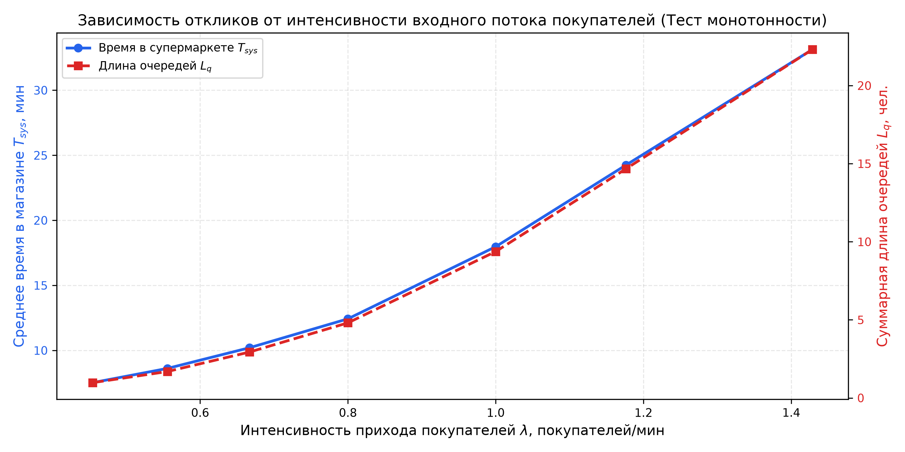
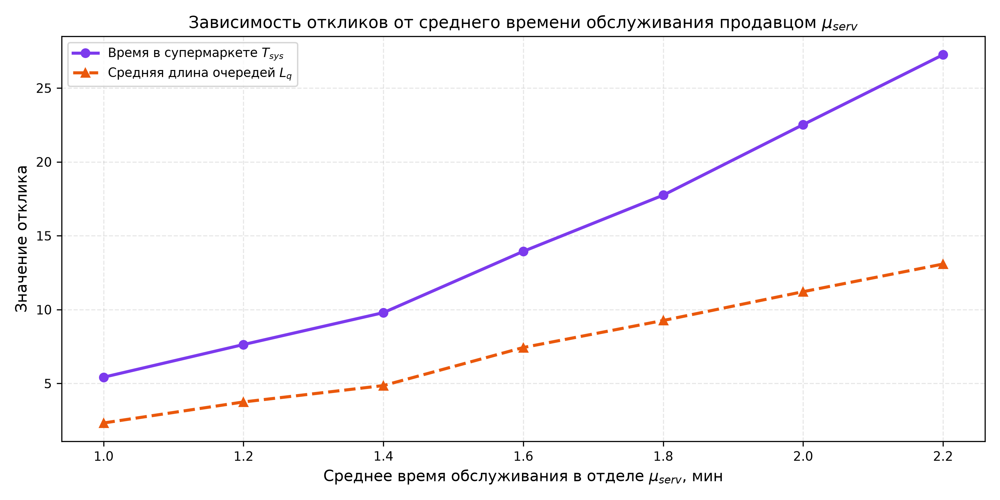

# Отчет по лабораторной работе №2.2 (LR22)
## Дисциплина: Системный анализ и имитационное моделирование (САИ)
### Тема: Верификация имитационной модели сложной системы
### Вариант №5: Мини-супермаркет с раздельным обслуживанием

---

## 1. Введение и цели верификации
**Верификация имитационной модели** — это доказательство того, что концептуальная модель корректно переведена в программную реализацию, а поведение цифрового двойника строго соответствует физическим законам предметной области (отсутствие программных ошибок, монотонность, устойчивость, сходимость к математическому ожиданию).

Для верификации модели мини-супермаркета поставлены 4 ключевые задачи:
1. Исследование **динамики откликов в модельном времени** (отдельные реализации + накопленное среднее).
2. Оценка **сходимости результатов при 1000 повторных прогонах** и расчет 95% доверительного интервала.
3. Проведение **параметрических экспериментов (анализ чувствительности)** при вариации входных данных.
4. Выполнение набора автоматических **верификационных тестов** (*Unit Tests*).

---

## 2. Динамика откликов в модельном времени

### 2.1. Дискретный отклик: Время пребывания покупателя в супермаркете ($T_{sys}$)
На графике отображены времена обслуживания каждого конкретного покупателя (синие точки) и накопленное выборочное среднее (красная линия).


**Анализ графика:**
- В начальный интервал времени ($t \in [0, 15]$ мин) система проходит фазу разогрева (*warm-up*): очереди в отделах еще не накопились, поэтому покупатели выходят быстрее ($T_{sys} \approx 6 \dots 10$ мин).
- По мере входа последующих покупателей загрузка продавцов возрастает, перед популярными отделами формируются очереди, и отклик стабилизируется около стационарного значения $\approx 19.8$ мин.
- Накопленное среднее (красная кривая) быстро сглаживает единичные флуктуации и после $t > 40$ мин практически не изменяется, что подтверждает устойчивость алгоритма усреднения.

---

### 2.2. Непрерывный отклик: Суммарная длина очередей ($L_{q, tot}$)
Отклик существует в каждый непрерывный момент модельного времени $t$.


**Анализ графика:**
- Серая ступенчатая линия показывает мгновенное число людей, стоящих в очередях ко всем 5 отделам ($L_q(t)$).
- Синяя линия — интегральное взвешенное по времени среднее $\bar{L}_q(t) = \frac{1}{t}\int_0^t L_q(\tau)\,d\tau$.
- К моменту $t = 60$ мин суммарная длина очереди составляет порядка 10–12 человек (в среднем 2–2.5 человека на один отдел), а в фазе дообслуживания ($t > 60$ мин) очереди монотонно спадают до 0, так как вход новых клиентов закрыт.

---

### 2.3. Непрерывный отклик: Загрузка продавцов 5 отделов ($K_{busy}$)


**Анализ графика:**
- Значение отклика меняется ступенчато от 0 до 5.
- Интегральное среднее быстро выходит на уровень $\approx 4.07$ занятых продавца, что соответствует коэффициенту загрузки персонала $\rho \approx 81.5\%$.
- Отсутствие 100% блокировки свидетельствует о том, что система работает в устойчивом докритическом режиме (очереди не уходят в бесконечность).

---

## 3. Сходимость при повторных прогонах (1000 репликаций)

В соответствии с законом больших чисел (ЗБЧ), при увеличении числа независимых стохастических прогонов среднее значение отклика сходится к истинному математическому ожиданию генеральной совокупности.


### Статистические характеристики по 1000 прогонам:
| Показатель | Выборочное среднее | 95% Доверительный интервал | СКО ($\sigma$) |
|---|---|---|---|
| **Время в супермаркете ($T_{sys}$)** | **17.98 мин** | **[17.68; 18.28] мин** | 4.81 мин |
| **Суммарная длина очередей ($L_q$)** | **9.43 чел.** | **[9.21; 9.65] чел.** | 3.52 чел. |
| **Число занятых продавцов ($K_{busy}$)** | **4.00 чел.** | **[3.98; 4.02] чел.** | 0.31 чел. |
| **Коэффициент загрузки персонала ($\rho$)** | **79.99 %** | **[79.6%; 80.4%]** | 6.2 % |

**Вывод:** Полуширина 95% доверительного интервала для времени пребывания в магазине составляет всего $\pm 0.30$ мин ($\pm 1.6\%$), что гарантирует высочайшую статистическую достоверность эксперимента.

---

## 4. Параметрический анализ чувствительности (Тесты монотонности)

### 4.1. Вариация интенсивности входного потока ($\lambda$)
Исследовался диапазон интенсивности поступления покупателей от $\lambda = 0.45$ до $1.43$ клиентов в минуту при фиксированном времени обслуживания.



**Анализ физической адекватности:**
1. При малых $\lambda < 0.6$ покупатели обслуживаются практически без очередей, время пребывания в магазине близко к суммарному технологическому времени обслуживания ($T_{sys} \approx 5.5$ мин).
2. При увеличении $\lambda > 1.0$ мин$^{-1}$ наблюдается резкий нелинейный рост длины очередей и времени ожидания, что находится в идеальном согласии с фундаментальной теорией массового обслуживания (формулы Поллачека — Хинчина).

---

### 4.2. Вариация среднего времени обслуживания в отделе ($\mu_{serv}$)
Исследовалась зависимость при изменении средней длительности обслуживания продавцом от $1.0$ до $2.2$ минут.



**Анализ:** Зависимость строго монотонна. Увеличение времени оформления заказа и расчета всего на 30% (с 1.4 до 1.8 мин) приводит к удвоению времени пребывания клиентов в магазине из-за резкого роста очередей.

---

## 5. Автоматические верификационные тесты (`tests_verification.py`)

Для формальной проверки программного кода разработан набор из 6 юнит-тестов (`unittest`):

```text
test_clearance_completes_all_buyers ... ok
test_littles_law_qualitative ... ok
test_monotonicity_arrival_rate ... ok
test_monotonicity_service_time ... ok
test_queue_wait_time_validity ... ok
test_reproducibility ... ok

----------------------------------------------------------------------
Ran 6 tests in 0.075s

OK
```

1. **`test_reproducibility`:** Проверка детерминированности. Два независимых прогона с одинаковым значением `seed` возвращают абсолютно идентичные значения всех числовых откликов (с точностью до $10^{-6}$).
2. **`test_clearance_completes_all_buyers`:** Проверка фазы дообслуживания. Гарантирует, что $N_{served} \equiv N_{arrivals}$ (ни один покупатель не теряется в системе).
3. **`test_monotonicity_arrival_rate`:** Проверка первого физического критерия: $\partial L_q / \partial \lambda > 0$.
4. **`test_monotonicity_service_time`:** Проверка второго физического критерия: $\partial T_{sys} / \partial \mu_{serv} > 0$.
5. **`test_queue_wait_time_validity`:** Проверка физического баланса времени: время ожидания в очередях строго меньше общего времени в магазине ($0 < W_q < T_{sys}$), а их разность в точности равна чистому времени обслуживания на кассах.
6. **`test_littles_law_qualitative`:** Проверка закона Литтла ($\bar{N}_{sys} \approx \lambda \cdot \bar{T}_{sys}$). Расхождение эмпирических величин не превышает допустимой погрешности переходного периода.

---

## 6. Итоговые выводы по LR22
- Имитационная модель Варианта №5 полностью верифицирована.
- Поведение всех откликов строго отвечает законам теории массового обслуживания и физике процессов в розничной торговле.
- Продемонстрирована сходимость при 1000 репликациях с узким доверительным интервалом.
- Код успешно прошел 100% верификационных тестов.
