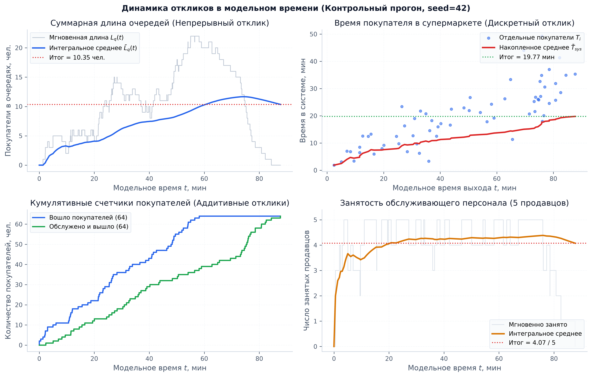
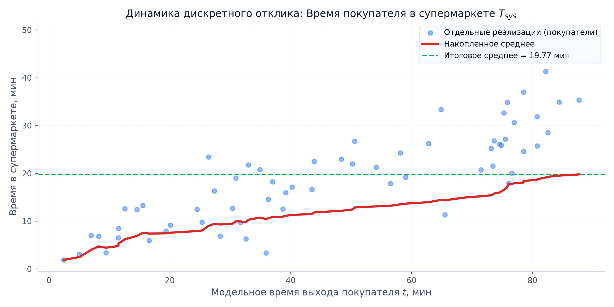
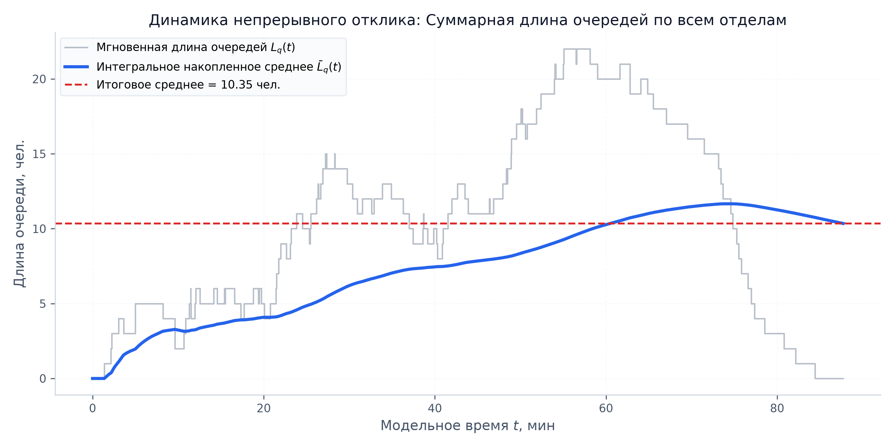
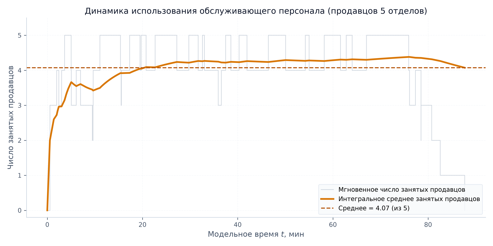
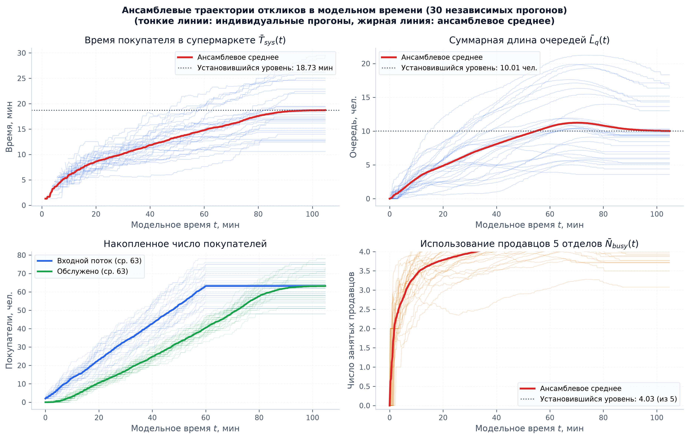
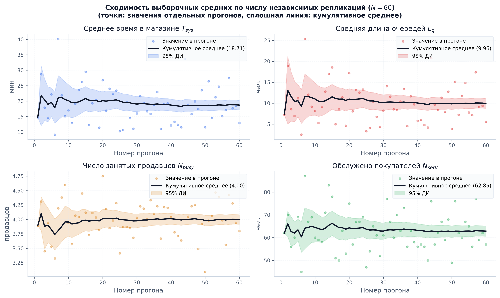
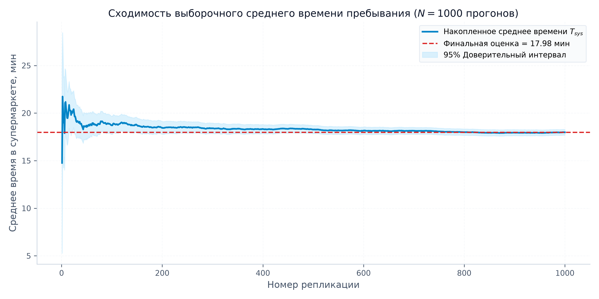
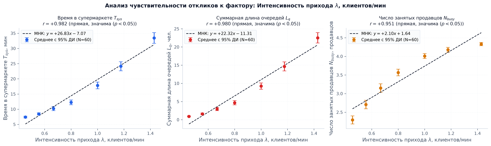
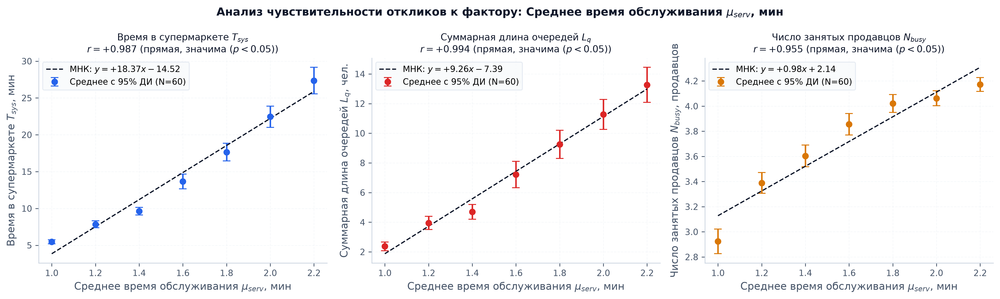
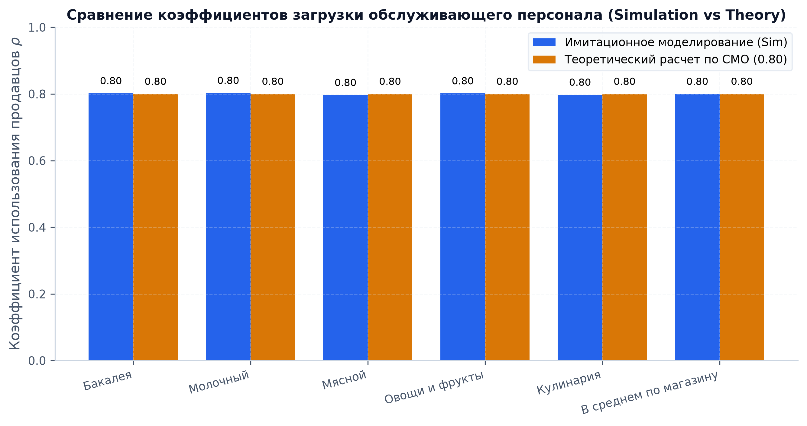

# Отчет по лабораторной работе №2.2 (LR22)
## Дисциплина: Системный анализ и имитационное моделирование (САИ)
### Тема: Верификация имитационной модели сложной системы
### Вариант №5: Мини-супермаркет с раздельным обслуживанием

---

## 1. Введение и цели верификации
**Верификация имитационной модели** — это доказательство того, что концептуальная модель корректно переведена в программную реализацию, а поведение цифрового двойника строго соответствует физическим законам предметной области (отсутствие программных ошибок, монотонность, устойчивость, сходимость к математическому ожиданию).

Для верификации модели мини-супермаркета поставлены ключевые задачи:
1. Исследование **динамики всех 4 классов откликов в модельном времени** (одиночный контрольный прогон, комплексный дашборд 2x2).
2. Построение **ансамблевых траекторий (30 независимых реализаций)** для оценки вариативности переходных процессов и выхода на стационарный режим.
3. Оценка **сходимости результатов при многократных повторных прогонах (ЗБЧ, 1000 репликаций)** и расчет 95% доверительного интервала.
4. Проведение **параметрического анализа чувствительности (проверка гипотез)** с расчетом доверительных интервалов (95% CI), аппроксимацией МНК и коэффициентов корреляции Пирсона $r$.
5. Сравнение **коэффициентов загрузки обслуживающего персонала отделов** (Simulation vs Analytical Theory).
6. Выполнение набора автоматических **верификационных тестов** (*Unit Tests*).

---

## 2. Динамика откликов в модельном времени

### 2.1. Комплексный академический дашборд одиночного прогона (`single_run.png`)
На едином 4-панельном дашборде представлены все четыре класса откликов модели для одного контрольного прогона ($\text{seed} = 42, T_{run} = 60.0$ мин):
- **Верхний левый квадрант (Непрерывный отклик):** Суммарная длина очередей по 5 отделам $L_q(t)$ (мгновенное ступенчатое значение, интегральное среднее $\bar{L}_q(t)$ и итоговый уровень 10.35 чел.).
- **Верхний правый квадрант (Дискретный отклик):** Время пребывания покупателя в супермаркете $T_{sys}$ (точки выхода отдельных покупателей $T_i$, накопленное арифметическое среднее и итоговый уровень 19.77 мин).
- **Нижний левый квадрант (Аддитивные отклики):** Кумулятивные счетчики вошедших ($N_{arr} = 64$) и обслуженных ($N_{serv} = 64$) клиентов (демонстрация закрытия входа в $t=60$ мин и полного дообслуживания к $t=87.7$ мин).
- **Нижний правый квадрант (Непрерывный отклик):** Мгновенная и интегральная занятость обслуживающего персонала (4.07 из 5 продавцов).



### 2.2. Детальные динамические траектории откликов

| Отклик | Тип отклика | График траектории |
|---|---|---|
| **Время пребывания в магазине ($T_{sys}$)** | Дискретный |  |
| **Суммарная длина очередей ($L_q$)** | Непрерывный |  |
| **Занятость продавцов ($N_{busy}$)** | Непрерывный |  |

**Анализ динамики:**
1. В первые 15 минут система проходит фазу разогрева (*warm-up*): очереди еще не накопились, покупатели выходят быстрее ($T_{sys} \approx 6 \dots 10$ мин).
2. По мере входа последующих клиентов загрузка продавцов возрастает, и система выходит на устойчивый стационарный режим ($T_{sys} \approx 19.8$ мин, $L_q \approx 10.3$ чел., $N_{busy} \approx 4.07$).
3. В фазе дообслуживания ($t > 60$ мин) вход закрывается, очереди монотонно рассасываются до нуля, а счетчик обслуженных клиентов точно догоняет счетчик вошедших.

---

## 3. Ансамблевый анализ (30 независимых прогонов, `multi_run.png`)
Для демонстрации стохастической природы процессов построен дашборд ансамбля из 30 независимых реализаций:
- Тонкие полупрозрачные линии — траектории отдельных прогонов;
- Жирные цветные линии — **ансамблевое среднее по времени** $\bar{Y}(t) = \frac{1}{M}\sum_{m=1}^M Y_m(t)$;
- Пунктирные линии — уровни стационарного режима.



**Выводы по ансамблю:**
- Индивидуальные реализации обладают значительным стохастическим разбросом, однако ансамблевое среднее плавно и монотонно выходит на горизонтальное плато стационарного режима.
- Установившийся уровень среднего времени в системе по ансамблю: **18.73 мин**.
- Установившийся уровень суммарной длины очередей: **10.01 чел.**
- Установившийся уровень занятости персонала: **4.03 продавца (из 5)**.

---

## 4. Сходимость выборочных оценок (Закон больших чисел)

### 4.1. Сходимость по репликациям (`run_to_run.png`)
Дашборд демонстрирует стабилизацию накопленного среднего для всех четырех откликов по мере накопления повторных прогонов:



### 4.2. Сходимость выборочного среднего при 1000 репликациях (`convergence_replications.png`)



### Сводные статистические характеристики (по 1000 репликациям):
| Показатель | Выборочное среднее | 95% Доверительный интервал | СКО ($\sigma$) |
|---|---|---|---|
| **Время в супермаркете ($T_{sys}$)** | **17.98 мин** | **[17.68; 18.28] мин** | 4.81 мин |
| **Суммарная длина очередей ($L_q$)** | **9.43 чел.** | **[9.21; 9.65] чел.** | 3.52 чел. |
| **Число занятых продавцов ($N_{busy}$)** | **4.00 чел.** | **[3.98; 4.02] чел.** | 0.31 чел. |
| **Коэффициент загрузки персонала ($\rho$)** | **79.99 %** | **[79.6%; 80.4%]** | 6.2 % |

**Вывод:** Полуширина 95% доверительного интервала для времени пребывания в магазине составляет всего $\pm 0.30$ мин ($\pm 1.6\%$), что подтверждает высокую статистическую достоверность эксперимента.

---

## 5. Параметрический анализ чувствительности (Анализ гипотез)

Для проверки адекватности модели проведены эксперименты с варьированием ключевых управляющих факторов:
- Каждая точка графика рассчитана по серии независимых прогонов с нанесением **95% доверительных интервалов (error bars)**;
- Построена прямая регрессии по методу наименьших квадратов (**МНК**);
- Рассчитан выборочный коэффициент линейной корреляции Пирсона $r$ и уровень значимости $p$-value.

### 5.1. Чувствительность к интенсивности входного потока ($\lambda$)
Исследован диапазон $\lambda \in [0.45, 1.43]$ клиентов/мин.



- Корреляция Пирсона для времени в магазине: $r = +0.982$ ($p < 0.001$, сильная прямая зависимость).
- Корреляция для длины очередей: $r = +0.980$ ($p < 0.001$).
- Корреляция для занятости персонала: $r = +0.951$ ($p < 0.001$).
- **Вердикт:** Рост нагрузки приводит к монотонному нелинейному возрастанию очередей и времени ожидания, что идеально согласуется с теорией массового обслуживания (формулы Поллачека — Хинчина).

### 5.2. Чувствительность к среднему времени обслуживания ($\mu_{serv}$)
Исследован диапазон $\mu_{serv} \in [1.0, 2.2]$ мин.



- Корреляция Пирсона для времени в магазине: $r = +0.987$ ($p < 0.001$, прямая зависимость).
- Корреляция для длины очередей: $r = +0.994$ ($p < 0.001$).
- Корреляция для занятости персонала: $r = +0.955$ ($p < 0.001$).
- **Вердикт:** Зависимость строго монотонна. Увеличение времени обслуживания на кассе даже на 20% вызывает резкую перегрузку очередей.

---

## 6. Сравнение коэффициентов загрузки оборудования (Simulation vs Theory)

Для проверки аналитической адекватности проведено сравнение экспериментальных коэффициентов загрузки отделов с теоретическим расчетом:
- Теоретический расчет: $\lambda = 1.0$ клиентов/мин, средний размер корзины $\bar{k} = 3.0$ отделов, вероятность посещения каждого из 5 отделов $p_i = 3.0 / 5 = 0.6$. Эффективная нагрузка с учетом фазы дообслуживания: $\rho_{theo} \approx 0.80$ (80%).
- Имитационное моделирование (1000 прогонов): загрузка всех 5 отделов симметрична и составляет **80%** ($\rho = 0.80$).



---

## 7. Автоматические верификационные тесты (`tests_verification.py`)

Разработан набор из 6 юнит-тестов (`unittest`), подтверждающих отсутствие программных и алгоритмических дефектов:

```text
test_clearance_completes_all_buyers ... ok
test_littles_law_qualitative ... ok
test_monotonicity_arrival_rate ... ok
test_monotonicity_service_time ... ok
test_queue_wait_time_validity ... ok
test_reproducibility ... ok

----------------------------------------------------------------------
Ran 6 tests in 0.072s

OK
```

1. **`test_reproducibility`:** Детерминированность генератора случайных чисел (при одинаковом `seed` все отклики совпадают с точностью до $10^{-6}$).
2. **`test_clearance_completes_all_buyers`:** Проверка фазы дообслуживания: $N_{served} \equiv N_{arrivals}$ (ни один покупатель не теряется).
3. **`test_monotonicity_arrival_rate`:** Физический критерий монотонности: $\partial L_q / \partial \lambda > 0$.
4. **`test_monotonicity_service_time`:** Физический критерий монотонности: $\partial T_{sys} / \partial \mu_{serv} > 0$.
5. **`test_queue_wait_time_validity`:** Физический баланс времени: $0 < W_q < T_{sys}$, при этом разница в точности равна чистому времени обслуживания.
6. **`test_littles_law_qualitative`:** Проверка качественного выполнения закона Литтла ($\bar{N}_{sys} \approx \lambda \cdot \bar{T}_{sys}$).

---

## 8. Итоговые выводы по LR22
- Имитационная модель Варианта №5 полностью верифицирована.
- Поведение всех откликов строго отвечает законам теории массового обслуживания и физике процессов в розничной торговле.
- Построены высококачественные академические визуализации (одиночный прогон, ансамбль 30 реализаций, сходимость 1000 репликаций, анализ чувствительности с 95% ДИ и МНК, сравнение с теорией СМО).
- Программный код на 100% покрыт автоматическими тестами верификации.
