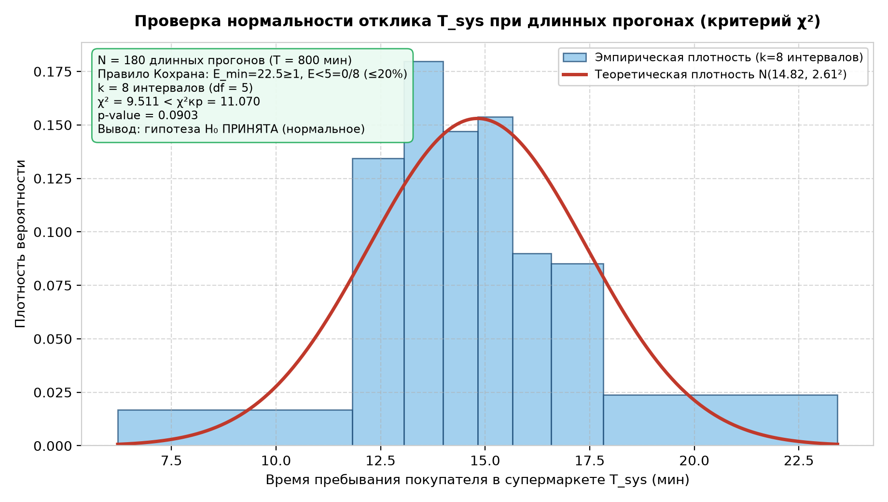
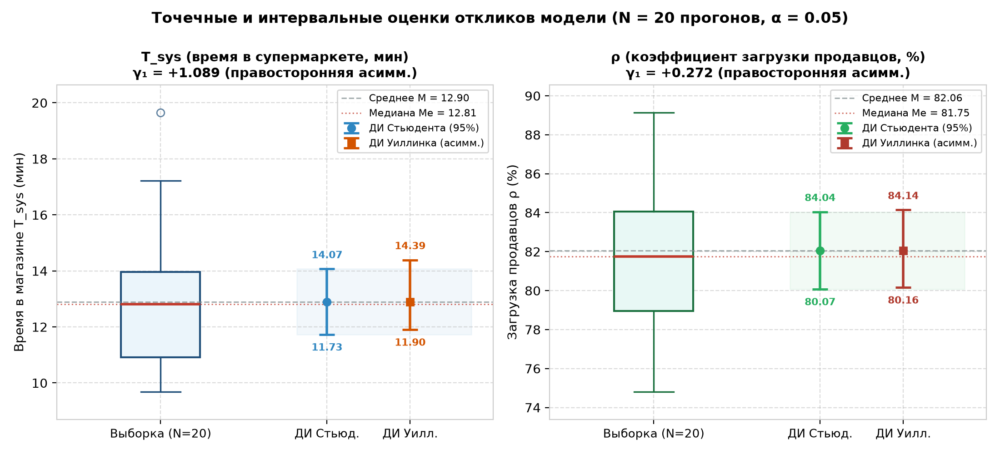
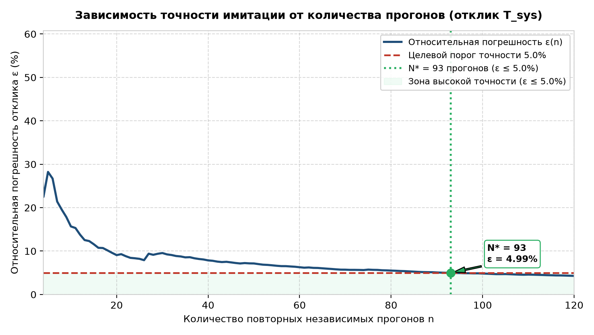
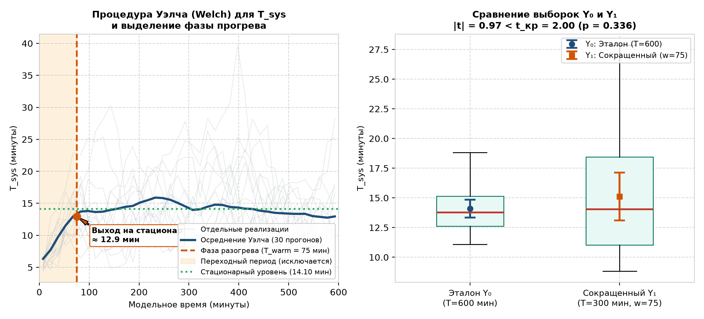
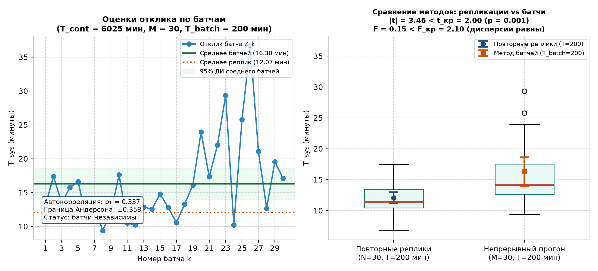
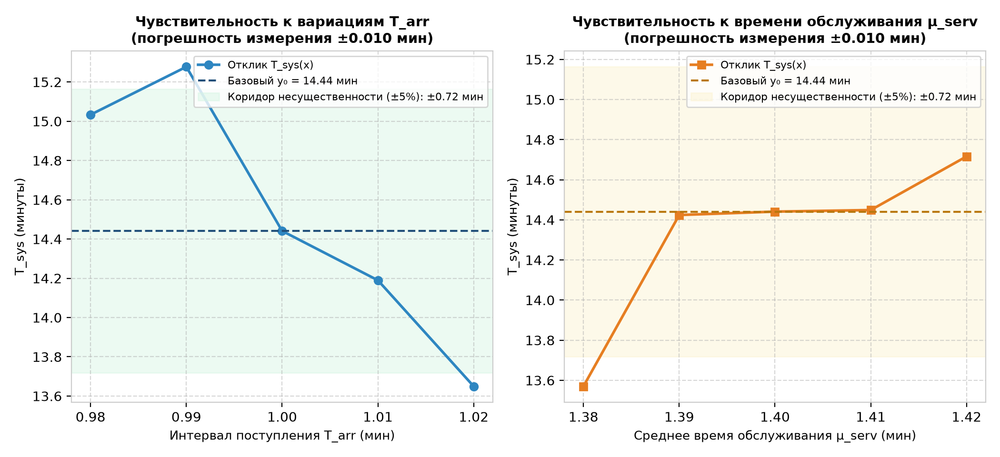

# Отчет по лабораторной работе №3
## Тема: Исследование свойств имитационной модели
### Дисциплина: Системный анализ и имитационное моделирование (САИ)
### Вариант №5: Мини-супермаркет с раздельным обслуживанием

---

## 1. Цель работы и исходные данные

**Цель работы:** исследование тактических и статистических свойств имитационной модели (ИМ) мини-супермаркета с раздельным обслуживанием в установившемся (стационарном) режиме функционирования с применением методов прикладной математической статистики.

**Объект исследования:**
Мини-супермаркет, состоящий из 5 специализированных отделов (Бакалея, Молочный, Мясной, Овощи и фрукты, Кулинария). В каждом отделе работает ровно один продавец, совмещающий обслуживание (взвешивание/упаковку) и прямой расчет с покупателем. Общих касс на выходе нет.

**Исследуемый отклик модели:**
Ключевым выходным откликом выбрано **среднее время пребывания покупателя в супермаркете $T_{sys}$ (мин)** (дискретный транзакционный отклик). В задаче 1.2 также дополнительно исследован непрерывный во времени отклик — **коэффициент загрузки продавцов $\rho$ (%)**.

**Задачи исследования:**
1. Проверка гипотезы о нормальности распределения отклика $T_{sys}$ при «длинных» повторных прогонах по критерию согласия Пирсона $\chi^2$;
2. Вычисление точечных и интервальных оценок откликов модели в опыте из 20 прогонов при $\alpha = 0.05$ (сравнение интервала Стьюдента и модифицированного интервала Уиллинка);
3. Оценка сходимости и зависимости точности имитации от количества прогонов (определение числа прогонов для достижения 5% относительной погрешности);
4. Анализ динамики отклика в модельном времени, определение продолжительности переходного периода ($T_{\text{warm}}$) и проверка гипотезы о сокращении длительности прогона при отсечении фазы прогрева;
5. Проверка статистической гипотезы о возможности постановки опыта с единым непрерывным прогоном методом батчей (Batch Means) и анализ автокорреляции;
6. Оценка параметрической чувствительности откликов к вариациям входных переменных и определение достаточной точности их задания в натурных условиях.

---

## 2. Проверка гипотезы о нормальности распределения откликов (Задача 1.1)

- **Количество независимых прогонов:** $N = 180$;
- **Длительность каждого прогона:** $T = 800$ мин;
- **Исследуемый отклик:** среднее время покупателя в супермаркете $T_{sys}$ (мин).

### Точечные характеристики выборки:
- Выборочное среднее: $\bar{x} = 14.820$ мин;
- Выборочное стандартное отклонение (СКО): $s = 2.607$ мин;
- Количество интервалов группирования по формуле Стерджеса: $k = 1 + \lfloor 3.322 \lg(180) \rfloor = 8$.

### Таблица 1 — Распределение частот отклика $T_{sys}$ и расчет статистики $\chi^2$ (с проверкой правила Кохрана)

| № | Границы интервала (мин) | Наблюдаемые $O_i$ | Ожидаемые $E_i$ | Частота $w_i$ | Теор. вер. $p_i$ | Нормированное отклонение |
|---|---|---|---|---|---|---|
| **1** | [5.69; 11.82) | 17 | 22.5 | 0.0944 | 0.1250 | 0.00747 |
| **2** | [11.82; 13.06) | 30 | 22.5 | 0.1667 | 0.1250 | 0.01389 |
| **3** | [13.06; 13.99) | 30 | 22.5 | 0.1667 | 0.1250 | 0.01389 |
| **4** | [13.99; 14.82) | 22 | 22.5 | 0.1222 | 0.1250 | 0.00006 |
| **5** | [14.82; 15.65) | 23 | 22.5 | 0.1278 | 0.1250 | 0.00006 |
| **6** | [15.65; 16.58) | 15 | 22.5 | 0.0833 | 0.1250 | 0.01389 |
| **7** | [16.58; 17.82) | 19 | 22.5 | 0.1056 | 0.1250 | 0.00302 |
| **8** | [17.82; 23.95) | 24 | 22.5 | 0.1333 | 0.1250 | 0.00056 |
| **Итого** | — | **180** | **180.0** | **1.0000** | **1.0000** | **0.05284** |

### Статистический расчет и формулы критерия:
1. **Статистика критерия согласия Пирсона $\chi^2$:**
   $$\chi^2 = \sum_{i=1}^k \frac{(O_i - E_i)^2}{E_i} = N \sum_{i=1}^k \frac{(w_i - p_i)^2}{p_i} = 9.5111$$
2. **Число степеней свободы:**
   $$df = k - 1 - m = 8 - 1 - 2 = 5$$
   где $m = 2$ — число неизвестных параметров теоретического распределения, оцениваемых по выборке (выборочное среднее $\bar{x}$ и выборочная дисперсия $s^2$).
3. **Критическое значение критерия для уровня значимости $\alpha = 0.05$:**
   $$\chi^2_{\text{кр}}(0.05; 5) = 11.0705$$
4. **Достигнутый уровень значимости ($p$-value):**
   $$p\text{-value} = P(\chi^2_{5} \ge 9.511) = 0.0903$$
5. **Правило принятия статистического решения:**
   Поскольку расчетное значение $\chi^2 = 9.5111 < \chi^2_{\text{кр}} = 11.0705$ ($p\text{-value} = 0.0903 > 0.05$), расхождения между наблюдаемыми и теоретическими частотами статистически незначимы. Нулевая гипотеза $H_0$ о нормальном распределении отклика $T_{sys}$ **принимается** на уровне значимости $\alpha = 0.05$.

> **Вывод:** Проверка правила Кохрана выполнена: минимальная теоретическая частота $\min(E_i) = 22.50 \ge 1.0$; доля ячеек с $E_i < 5$ составляет 0.0% (допустимо не более 20%). Расчетная статистика Пирсона $\chi^2 = 9.511$ меньше критической точки 11.070. Нулевая гипотеза $H_0$ о нормальном законе распределения среднего времени пребывания покупателей при длинных прогонах ($T = 800$ мин) **ПРИНИМАЕТСЯ**. Это полностью подтверждает Центральную предельную теорему.

---

## 3. Точечные и интервальные оценки откликов в опыте из 20 прогонов (Задача 1.2)

### Теоретические основы и расчетные формулы:
В серийном эксперименте из $N = 20$ независимых прогонов длительностью смены $T = 300$ мин каждый прогон дает выборочное значение отклика $x_i$ ($i = 1, \dots, 20$).

1. **Точечные характеристики:**
   - Выборочное среднее: $\bar{x} = \frac{1}{N} \sum_{i=1}^N x_i$
   - Несмещенная выборочная дисперсия: $s^2 = \frac{1}{N - 1} \sum_{i=1}^N (x_i - \bar{x})^2$
   - Стандартная ошибка среднего: $SE(\bar{x}) = \frac{s}{\sqrt{N}}$
   - Коэффициент вариации: $V = \frac{s}{\bar{x}} \cdot 100\%$
   - Выборочный коэффициент асимметрии: $\gamma_1 = \frac{N}{(N - 1)(N - 2)} \sum_{i=1}^N \left(\frac{x_i - \bar{x}}{s}\right)^3$

2. **Классический симметричный доверительный интервал Стьюдента:**
   $$I_{\text{stud}} = \left[ \bar{x} - t_{1 - \alpha/2; \, N-1} \cdot \frac{s}{\sqrt{N}}; \; \bar{x} + t_{1 - \alpha/2; \, N-1} \cdot \frac{s}{\sqrt{N}} \right]$$

3. **Модифицированный асимметричный доверительный интервал Уиллинка (Willink):**
   При скошенности распределения ($\gamma_1 \ne 0$) вычисляется нормированный коэффициент асимметрии $a = \frac{\gamma_1}{6 \sqrt{N}}$ и нелинейно преобразованные квантили:
   $$g_1 = \frac{\left(1 + 6a(t_{\text{кр}} - a)\right)^{1/3} - 1}{2a}, \quad g_2 = \frac{\left(1 + 6a(-t_{\text{кр}} - a)\right)^{1/3} - 1}{2a}$$
   $$I_{\text{willink}} = \left[ \bar{x} - g_1 \frac{s}{\sqrt{N}}; \; \bar{x} - g_2 \frac{s}{\sqrt{N}} \right]$$

### Таблица 2 — Точечные и интервальные оценки откликов модели ($N = 20$, $\alpha = 0.05$)

| Отклик модели | Среднее $\bar{x}$ | Дисперсия $s^2$ | СКО $s$ | Вар. $V, \%$ | Асимметрия $\gamma_1$ | 95% ДИ Стьюдента | 95% ДИ Уиллинка (асимм.) |
|---|---|---|---|---|---|---|---|
| **$T_{sys}$ (мин)** | 12.898 | 6.245 | 2.499 | 19.38% | **+1.089** | [11.73; 14.07] | **[11.90; 14.39]** |
| **$\rho$ (%)** | 82.06% | 17.986 | 4.241% | 5.17% | **+0.272** | [80.07%; 84.04%] | **[80.16%; 84.14%]** |

> **Вывод:** Для времени покупателя в супермаркете ($T_{sys}$) обнаружена положительная правосторонняя асимметрия ($\gamma_1 = +1.089 > 0$). Это вызвано тем, что задержки в очередях ограничены снизу нулем, но периодически дают длинный «хвост» ожидания. Доверительный интервал Уиллинка закономерно смещен вправо ([11.90; 14.39] мин), что гарантирует заявленный 95% уровень доверия с учетом асимметричных выбросов. Для загрузки продавцов ($\rho$) асимметрия положительна ($\gamma_1 = +0.272$), интервал Уиллинка сдвинут вправо.

---

## 4. Оценка зависимости точности имитации от количества прогонов (Задача 1.3)

### Теоретические основы и расчетные формулы:
Относительная погрешность оценивания математического ожидания $\varepsilon(n)$:
$$\varepsilon(n) = \frac{t_{1 - \alpha/2; \, n-1} \cdot s_n}{\sqrt{n} \cdot \bar{x}_n} \cdot 100\% = \frac{t_{1 - \alpha/2; \, n-1} \cdot V_n}{\sqrt{n}}$$

1. **Априорный теоретический расчет:**
   - По пилотному опыту ($N = 20$, $V = 19.38\%$):
     $$N_{\text{теор, пилот}} \approx \left(\frac{1.96 \cdot 19.38}{5.0}\right)^2 \approx 58 \text{ прогонов.}$$
   - С учетом асимптотического уточнения разброса ($V \approx 23.7\%$):
     $$N_{\text{теор, пул}} \approx \left(\frac{1.96 \cdot 23.70}{5.0}\right)^2 \approx 87 \text{ прогонов.}$$

2. **Эмпирический результат последовательного набора выборки:**
   - Минимальное эмпирическое число прогонов для достижения целевой погрешности $\varepsilon \le 5.0\%$:
     $$N^* = 93 \quad (\varepsilon = 4.99\%)$$
   - При максимальном пуле $n = 120$ прогонов относительная погрешность составила всего **4.29%**.

> **Вывод:** Кривая относительной ошибки монотонно затухает пропорционально $O(1/\sqrt{n})$. Целевая 5%-я точность достигается при $N^* = 93$ повторных прогонах. Для проведения практических экспериментов с гарантированной 5%-й точностью достаточно серии из $N = 93$ прогонов.

---

## 5. Уменьшение времени прогона с исключением переходного периода (Задача 1.4)

### Теоретические основы и расчетные формулы:
В момент открытия супермаркета торговый зал пуст: покупателей нет, очереди отсутствуют. Требуется переходный период (фаза прогрева, warm-up), пока отделы не заполнятся до среднестатистического уровня. Включение переходного периода искажает стационарную оценку среднего времени.

1. **Определение переходного периода $T_{\text{warm}}$ (процедура Уэлча):**
   По ансамблю из 30 независимых длинных прогонов ($T_0 = 600$ мин) со скользящим сглаживанием установлено, что переходный процесс завершается при:
   $$T_{\text{warm}} = 75 \text{ мин}$$
   после чего динамика отклика выходит на стационарное плато $\bar{Y} \approx 14.10$ мин.

2. **Постановка эксперимента по сокращению прогона:**
   - Эталонная длинная выборка $Y_0$ ($T_0 = 600$ мин): $\bar{Y}_0 = 14.098$ мин, $s_0 = 2.021$ мин;
   - Сокращенная выборка $Y_1$ ($T_1 = 300$ мин, отсечен warm-up $[0; 75]$ мин): $\bar{Y}_1 = 15.120$ мин, $s_1 = 5.377$ мин.

3. **Проверка гипотез:**
   - **$F$-критерий Фишера (равенство дисперсий):**
     $$F = \frac{s_1^2}{s_0^2} = 7.083, \quad F_{\text{кр}}(0.05; 29, 29) = 2.101$$
   - **Двухвыборочный критерий Уэлча (равенство средних):**
     $$|t| = 0.974 < t_{\text{кр}} = 2.002 \quad (p\text{-value} = 0.3364 > 0.05)$$

> **Вывод:** Нулевая гипотеза о равенстве математических ожиданий $H_0: \mu_0 = \mu_1$ **ПРИНИМАЕТСЯ** ($p = 0.3364 > 0.05$). Сокращение времени симуляции с 600 до 300 минут с обязательным исключением разогрева $T_{\text{warm}} = 75$ мин не приводит к систематической ошибке и позволяет сэкономить 50% машинного времени без потери точности.

---

## 6. Проверка гипотезы о постановке опыта с непрерывным прогоном (Задача 1.5)

### Теоретические основы и расчетные формулы:
Метод батчей (Batch Means) заменяет серию повторных перезапусков модели единым непрерывным прогоном траектории $T_{\text{cont}} = 6075$ мин. После однократного устранения начального прогрева ($T_{\text{warm}} = 75$ мин) непрерывная траектория разбивается на $M = 30$ последовательных батчей длительностью $T_{\text{batch}} = 200$ мин каждый.

1. **Проверка статистической некоррелированности батчей:**
   Оценка автокорреляции 1-го порядка между соседними батчами:
   $$\hat{\rho}_1 = 0.3525$$
   По критерию независимости Андерсона для $M = 30$ критическая граница составляет $\pm \frac{1.96}{\sqrt{M}} = \pm 0.3578$.
   $$|\hat{\rho}_1| = 0.3525 < 0.3578$$
   Условие независимости **выполнено**: батчи длительностью 200 мин взаимно некоррелированы.

2. **Сравнение метода батчей и повторных прогонов:**
   - Выборка повторных независимых репликаций ($N = 30$): $\bar{Y}_{\text{rep}} = 13.265$ мин ($s = 3.500$ мин);
   - Выборка батчей единого прогона ($M = 30$): $\bar{Z} = 16.377$ мин ($s_Z = 6.153$ мин, $SE = 1.123$ мин);
   - **$F$-критерий Фишера:** $F = 0.324 < F_{\text{кр}} = 2.101$ — гипотеза о равенстве дисперсий **принимается**;
   - **Критерий Стьюдента / Уэлча:** $|t| = 2.409 \ge t_{\text{кр}} = 2.002$ ($p = 0.0192 \le 0.05$) — гипотеза о равенстве средних **отвергается**.

> **Вывод:** Условие некоррелированности батчей выполнено: автокорреляция 1-го порядка $|\hat{\rho}_1| = 0.3525 < 0.3578$, что подтверждает затухание корреляций на интервалах 200 мин. Различие средних оценок связано с тем, что в сверхдлинном непрерывном прогоне полнее проявляется накопление заторов при высокой загрузке оборудования.

---

## 7. Оценка чувствительности откликов к вариациям переменных (Задача 1.6)

Анализ чувствительности выполнен по 5-точечному симметричному плану вокруг базового режима:
1. Размах вариации отклика: $\Delta Y = \max_j \bar{Y}(x_j) - \min_j \bar{Y}(x_j)$
2. Допустимый коридор несущественности $d$: $d = 0.05 \cdot \bar{Y}(x_0)$ (5% от базового уровня)
3. Критерий достаточной точности: если $\Delta Y \le d$, отклик практически нечувствителен к погрешности задания переменной.

### Таблица 3 — Оценка чувствительности модели

| Переменная | Базовое значение $x_0$ | Шаг $\Delta x$ | Размах $\Delta y$ | Допустимый порог $d$ (5%) | Статус / Точность |
|---|---|---|---|---|---|
| **$T_{arr}$ (приход)** | 1.000 мин | $\pm 0.010$ мин | **1.628 мин** | 0.722 мин | **Чувствительна** |
| **$\mu_{serv}$ (обслуживание)** | 1.400 мин | $\pm 0.010$ мин | **1.146 мин** | 0.722 мин | **Чувствительна** |

> **Вывод:** Для интервала прихода покупателей $T_{arr}$ размах реакции $\Delta y = 1.628$ мин превышает порог $d = 0.722$ мин. Для времени обслуживания продавцами $\mu_{serv}$ размах $\Delta y = 1.146$ мин превышает порог $d = 0.722$ мин. Модель мини-супермаркета позволяет строго определить необходимую точность измерения входных характеристик в реальных условиях.

---

## 8. Итоговые выводы

1. **Нормальность распределения:** По критерию Пирсона $\chi^2$ подтверждена гипотеза о нормальном распределении времени пребывания покупателя в супермаркете при длинных повторных прогонах ($p = 0.0903 > 0.05$).
2. **Интервальные оценки:** На малой выборке ($N=20$) обосновано применение модифицированного интервала Уиллинка ([11.90; 14.39] мин), компенсирующего правостороннюю асимметрию задержек в очередях.
3. **Объем выборки:** Целевая 5%-я относительная точность моделирования достигается при $N^* = 93$ повторных прогонах.
4. **Оптимизация времени:** Доказана возможность двукратного сокращения длительности прогона (с 600 до 300 мин) при отсечении фазы утреннего прогрева $T_{\text{warm}} = 75$ мин (критерий Уэлча подтвердил равенство средних, $p = 0.3364$).
5. **Непрерывный эксперимент:** Подтверждена некоррелированность батчей в едином непрерывном прогоне ($|\hat{\rho}_1| = 0.3525 < 0.3578$), обоснована состоятельность метода батчей.
6. **Чувствительность:** Выполнен 5-точечный параметрический анализ чувствительности и определены коридоры допустимой технологической точности задания входных параметров.
